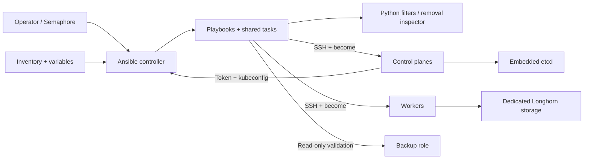
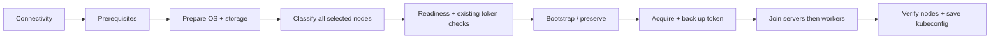

# Architecture

## Components and interactions

This repository is Ansible content for Carekube infrastructure, not the Semaphore web application. Semaphore or a local user launches the same playbooks. See [requirements](Requirements.md) and [decisions](Adr.md).

| Component | Responsibility |
|-----------|----------------|
| `playbooks/` | Connectivity, prerequisite reporting, OS preparation, RKE2 install/preservation, and full-cluster removal. |
| `tasks/` | Controller setup, frozen target/readiness barriers, classification, token acquisition, verification, storage selection, and guarded cleanup. |
| `filter_plugins/rke2_state.py` | Safely parse YAML/JSON state, compare managed fields/version, classify installs, validate Kubernetes node JSON. |
| `library/rke2_remove_inspect.py` | Read-only target inspection of ownership, service/environment files, processes, mounts, disks, network state, and cleanup allowlists. |
| Inventory and `vars/` | Node roles, connection details, requirement profiles, and installation settings. |
| `tests/` | Python unit/orchestration tests and local Ansible fixtures. |

## Deployment and data flow

Connectivity pings before gathering facts without escalation. Validation collects read-only evidence and normalizes category results. Preparation changes OS state independently of installation. Installation freezes role-group targets intersected with the initial host selection; failed/unreachable hosts remain barrier dependencies. The explicit token source must be selected. A matching existing source is read and its token backed up before bootstrap mutation; fresh bootstrap acquires its generated token afterward. Controller-only aliases are excluded from cluster targets.

RKE2 generates the fresh bootstrap token unless `rke2_join_token` is supplied; expansion reads the existing token from the selected source without rotation. Fresh control planes use embedded etcd: only bootstrap gets `cluster-init`; others get the registration URL. The upstream installer is executed on new/binary-only nodes, with a pinned Linux AMD64 version. Preflight performs HEAD requests for the tarball and checksum. RKE2 manages Cilium; server configuration defaults to no ingress implementation. Platform applications and Longhorn deployment are separate concerns.

Classification returns `new`, `incomplete_install`, `matching`, `drifted`, `unknown`, or `inspection_error`. Matching means selected managed fields/version agree, not that every configuration field or cluster identity has been independently verified. Matching nodes are not rewritten/restarted; ambiguous data-bearing state is refused. Final verification reads Kubernetes node JSON directly on a healthy selected control plane.

## Storage and state

Worker disk selection rejects OS disks, signatures, partitions, mounts, swap, LVM, RAID, holders, and unknown identities. Existing valid dedicated mounts are preserved; a single verified unused candidate can be formatted ext4 and mounted persistently by UUID. Ambiguous selection fails. Discovery is repeated immediately before formatting. Prerequisites are advisory evidence, not authorization to bypass preparation checks.

RKE2 state resides on nodes in configuration, managed JSON markers, services, binaries, and embedded etcd/runtime data. Readiness facts live only in the Ansible run and reset each execution. Controller token backups and kubeconfigs persist separately. See [Configuration](Configuration.md) for paths and permissions.

Removal requires full inventory scope and explicit confirmation. It inspects every node, then removes workers, other servers, and bootstrap serially. Official runtime cleanup is bounded and independently verified; guards prevent recursive deletion with remaining processes/mounts. Longhorn storage and OS preparation persist. Failure stops subsequent nodes but cannot roll back prior removals. Detailed recovery and migration procedures belong in [Operations](Operations.md).

## Constraints and external dependencies

Targets rely on Linux/systemd utilities, apt packages, SSH/Python, RKE2 release hosting, and the installer endpoint. Installation uses fixed `/usr/local/bin/rke2` assumptions; removal deliberately supports the standard tarball layout and fixed runtime/configuration paths. Configurable paths do not imply arbitrary-layout support. No deployment manifests for Semaphore, external load balancers, VM provisioning, REST service, or database for this automation are present.
